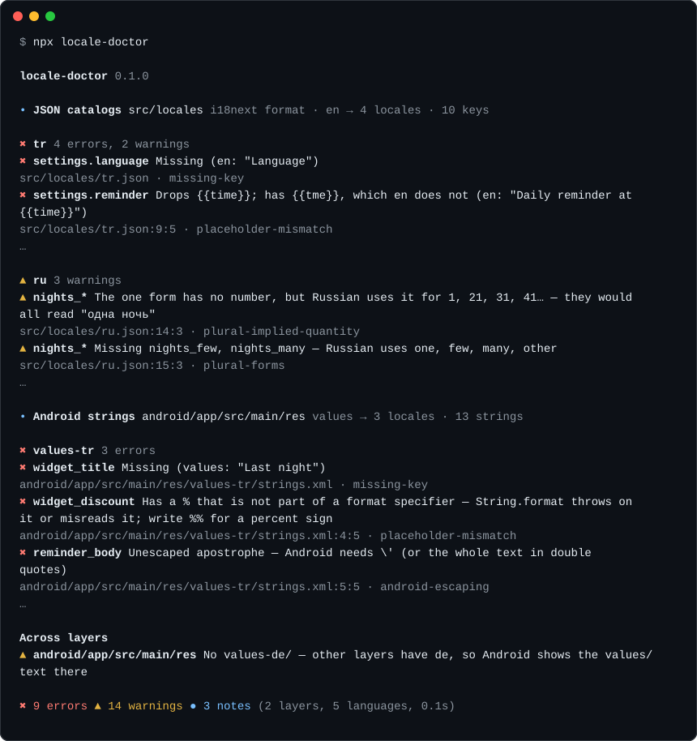

# locale-doctor

[](https://github.com/aozkurt/locale-doctor/actions/workflows/ci.yml)
[](LICENSE)

A zero-config checkup for the translations of **mobile and hybrid apps**: your JSON catalogs and your Android `strings.xml`, side by side.

```sh
npx locale-doctor
```

No config, no dependencies. It finds the translation files on its own, checks every language against the source language, and checks the layers against each other.



This is part of the output for [`test/fixtures/capacitor-app`](test/fixtures/capacitor-app), a small app with planted bugs. Run `npx locale-doctor test/fixtures/capacitor-app` in a clone to see all of it.

<details>
<summary>The same output as text</summary>

<!-- demo:start -->
```
locale-doctor 0.1.0

• JSON catalogs  src/locales  i18next format · en → 4 locales · 10 keys

  ✖ tr  4 errors, 2 warnings
    ✖ settings.language  Missing (en: "Language")
      src/locales/tr.json · missing-key
    ✖ settings.reminder  Drops {{time}}; has {{tme}}, which en does not (en: "Daily reminder at {{time}}")
      src/locales/tr.json:9:5 · placeholder-mismatch
    …

  ▲ ru  3 warnings
    ▲ nights_*  The one form has no number, but Russian uses it for 1, 21, 31, 41… — they would all read "одна ночь"
      src/locales/ru.json:14:3 · plural-implied-quantity
    ▲ nights_*  Missing nights_few, nights_many — Russian uses one, few, many, other
      src/locales/ru.json:15:3 · plural-forms
    …

• Android strings  android/app/src/main/res  values → 3 locales · 13 strings

  ✖ values-tr  3 errors
    ✖ widget_title  Missing (values: "Last night")
      android/app/src/main/res/values-tr/strings.xml · missing-key
    ✖ widget_discount  Has a % that is not part of a format specifier — String.format throws on it or misreads it; write %% for a percent sign
      android/app/src/main/res/values-tr/strings.xml:4:5 · placeholder-mismatch
    ✖ reminder_body  Unescaped apostrophe — Android needs \' (or the whole text in double quotes)
      android/app/src/main/res/values-tr/strings.xml:5:5 · android-escaping
    …

Across layers
  ▲ android/app/src/main/res  No values-de/ — other layers have de, so Android shows the values/ text there

✖ 9 errors  ▲ 14 warnings  ● 3 notes  (2 layers, 5 languages, 0.1s)
```
<!-- demo:end -->

</details>

## Why

Capacitor, Ionic and React Native apps keep their translations in two places: JSON catalogs for the screens, and Android string resources for the app name, notifications and widgets. Translation linters read the JSON; Android Lint needs a Gradle build. Bugs fall through the gap:

- A Turkish translator writes `%50 indirim` ("50% off") in a formatted Android string, and `String.format` throws at runtime.
- `l'application` in a French `strings.xml` without a backslash: Android needs `\'`.
- Russian gets the `one` and `other` forms copied from English, but needs `few` and `many` too, and its `one` also covers 21, 31, 41…, so "одна ночь" (one night) is wrong for 21 nights.
- English `<item quantity="zero">` never shows: Android uses `other` for 0 in English.
- The app speaks 16 languages, but its notification channel names only 3.

locale-doctor catches all of these with one command, before your users do.

## What it checks

| Rule | Severity | Finds |
| --- | --- | --- |
| `parse-error` | error | A JSON or XML file that cannot be read |
| `duplicate-key` | error | A key defined twice: JSON keeps only the last one, and Android fails the build |
| `missing-file` | error | A namespace file that a locale folder lacks (`fr/home.json`) |
| `missing-key` | error | A key the source has and a translation lacks. When every translation lacks it, it is reported once |
| `extra-key` | warning | A key only a translation has: left over, or a typo |
| `type-mismatch` | error | Text in one language, a plural or a list in another |
| `array-size` | warning | An Android `string-array` with another number of items |
| `placeholder-mismatch` | error | `{name}`, `{{name}}` or `%1$s` dropped, misspelled or of another type; a lone `%` in a formatted Android string. A dropped tag such as `<b>` or `<1>` is a warning |
| `message-syntax` | error | An ICU message that does not parse |
| `plural-forms` | warning | Plural forms a language needs and lacks (Russian: `few`, `many`), and forms it never uses. An error when `other` is missing |
| `plural-implied-quantity` | warning | A `one` form without the number, in a language where `one` also means 21 or 0 |
| `empty-value` | warning | An empty translation |
| `untranslated` | warning | Text left the same as the source, or a Japanese, Russian or Arabic translation without a single Japanese, Cyrillic or Arabic letter |
| `android-escaping` | error | An unescaped `'` or a leading `@` in `strings.xml`. Unescaped `"` is a warning: Android drops it |
| `not-translated-anywhere` | warning | An Android string that no locale translates. A note when it looks like a name: then it should be `translatable="false"` |
| `layer-coverage` | warning | A language the JSON catalogs have and Android lacks, or the other way round |

Plural rules come from Node's built-in `Intl.PluralRules`, so every language works without tables. Forms a language uses only for numbers like 1,000,000 (French, Spanish, Italian and Portuguese `many`) get a single note, not a warning per string.

## What it reads

**JSON catalogs** named after their language, in any folder:

- one file per locale: `src/locales/en.json`, `i18n/pt-BR.json`, `lang/zh_Hant.json`
- one folder per locale: `public/locales/en/common.json`, `public/locales/de/common.json`

It works out the placeholder style of each folder: i18next (`{{name}}`, `key_one`/`key_other`, `$t(key)`, `<1>…</1>`), ICU MessageFormat (`{count, plural, …}`, `<b>…</b>`, as in react-intl, next-intl and FormatJS), or plain `{name}`, `%{name}` and `%s`. English is the source when there is one; otherwise the most complete locale. Nested keys become `settings.title`.

**Android resources** in any `res/` folder: `<string>`, `<plurals>` and `<string-array>` in `values/` (the source) and `values-tr/`, `values-pt-rBR/`, `values-b+zh+Hans/` and so on. It honors `translatable="false"`, `formatted="false"` and `tools:ignore="MissingTranslation"`, and knows that Capacitor's `package_name` and `custom_url_scheme` are not text.

Inside a git repository it reads only the files git tracks or would track, so `.gitignore` applies. Elsewhere it skips `node_modules`, build output and the copies of the web build that Capacitor puts in the native projects.

## Usage

```sh
npx locale-doctor [folder] [options]
```

| Option | |
| --- | --- |
| `-s, --source <locale>` | The language the others are translated from (default: `en`, or the most complete locale) |
| `-f, --format <name>` | `pretty` (default), `json`, or `github` for annotations in GitHub Actions |
| `-c, --config <file>` | A config file (default: `locale-doctor.config.json`, or `"localeDoctor"` in `package.json`) |
| `--strict` | Exit with 1 on warnings too |
| `-q, --quiet` | Show errors only |
| `--all` | Show every problem (the default stops at 25 a locale) |
| `--no-color` | Plain output (`NO_COLOR` and `FORCE_COLOR` work too) |

It exits with 0 when there are no errors, 1 when there are (or warnings, with `--strict`), and 2 when it finds nothing to check or an option is wrong.

### In GitHub Actions

```yaml
- uses: actions/checkout@v4
- uses: actions/setup-node@v4
  with:
    node-version: 22
- run: npx locale-doctor --format github
```

Each problem then shows up as an annotation on its line in the pull request.

### Config

Only needed to quiet things down. `locale-doctor.config.json`:

```json
{
  "source": "en",
  "ignore": ["legacy/**"],
  "ignoreKeys": ["debug.*"],
  "allowIdentical": ["OK", "Email"],
  "rules": {
    "untranslated": "off",
    "extra-key": "error"
  }
}
```

`ignore` takes path globs relative to the checked folder, `ignoreKeys` takes keys with `*` as a wildcard, `allowIdentical` lists texts that may stay the same as the source, and `rules` sets a rule to `error`, `warning`, `info` or `off`.

### From code

```js
import { check } from "locale-doctor";

const result = await check({ root: "apps/mobile" });
console.log(result.summary); // { errors: 2, warnings: 5, infos: 0 }
```

`result.issues` lists each problem with its rule, severity, message, locale, key, file, line and column.

## How it differs

For web-only projects, [i18n-check](https://github.com/lingualdev/i18n-check) and [Locale Guard](https://github.com/Mohamed-Almarag/locale-guard) are excellent; Locale Guard even comments on pull requests. locale-doctor is for apps that also ship native string resources: it reads Android's `strings.xml`, knows its escaping and `String.format` rules, and compares the languages of the layers. It also needs no setup: no source flag, no format flag, no file patterns.

## Not yet

- iOS `Localizable.strings` and String Catalogs (`.xcstrings`) ([#1](https://github.com/aozkurt/locale-doctor/issues/1))
- Flutter `.arb` files ([#2](https://github.com/aozkurt/locale-doctor/issues/2))
- Catalogs written as JavaScript or TypeScript modules ([#3](https://github.com/aozkurt/locale-doctor/issues/3))
- Store listings (fastlane metadata) and their length limits ([#4](https://github.com/aozkurt/locale-doctor/issues/4))
- A ready-made GitHub Action ([#5](https://github.com/aozkurt/locale-doctor/issues/5))

Ideas and pull requests are welcome. The issues marked [good first issue](https://github.com/aozkurt/locale-doctor/labels/good%20first%20issue) are small and point to the code to start from, and [CONTRIBUTING.md](CONTRIBUTING.md) explains the setup.

## License

[MIT](LICENSE)
